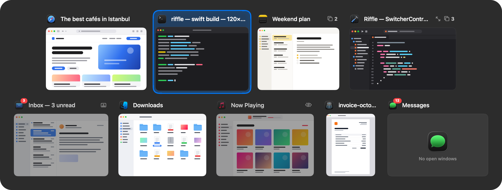

# Riffle

A window switcher for macOS. Hold ⌥ and press Tab to flip through **every window on every desktop**, like riffling through a deck of cards. Written in Swift for macOS 26 and its Liquid Glass design.



## Layouts

- **Deck** (default): big, readable cells. Each window gets a cell with the app icon and a large title on top and a live thumbnail below that keeps the window's own shape.
  - Up to four windows sit side by side on one row. More are spread over balanced rows, never leaving one window alone on the last row.
  - A glowing plate slides from cell to cell to show the selection, and the selected thumbnail lifts slightly.
  - Minimized, hidden, full-screen windows and windows on other desktops are marked with small symbols in their header.
  - Hovering over a cell shows four buttons in a frosted tray: quit the app, close, minimize and full screen. Apps without open windows only get the quit button; Finder can't be quit, so its windows don't get one.
  - The panel shows no hint line and no tooltips. The keys are listed in Settings → Shortcuts.
- **Stage**: the selected window large and live on a stage, every window on a filmstrip below.
- **Icons**: big app icons, like the Dock.
- **Titles**: a compact list with an icon and a title per row, as wide as the longest title. The lightest layout: no thumbnails are captured.
- **List**: the windows on the left, a large preview of the selected one on the right.

Every layout works in dark and light mode. The size is **Automatic** (default), small, medium or large. Automatic sizes the deck by the number of windows: a few show large, and as more open the cells shrink until all of them fit on screen (past the smallest readable size the deck scrolls).

## Features

| | |
|---|---|
| **⌥ Tab or ⌘ Tab** | All windows, most recently used first (⇧ goes backwards). A quick tap switches to the previous window without ever showing the panel. New setups start on ⌥ Tab, which leaves macOS's own ⌘ Tab alone; pick ⌘ Tab in the welcome window or in Settings and Riffle takes the place of the macOS app switcher, giving it back when it quits. Shortcuts show and listen to the keys as macOS reports them, the same way menus do, so a change in System Settings → Keyboard → Modifier Keys is followed as it is. |
| **The key above Tab** | Same hold key, only the windows of the app in front (`` ` `` on a US keyboard, `"` on a Turkish Q keyboard). |
| **Up to 9 shortcuts** | Each has its own keys (any combination of ⌃ ⌥ ⌘), its own apps (all, the one in front, all but the one in front, the one under the pointer), places (all desktops, this desktop, this screen) and order (recently used, launch order, alphabetical, by desktop). Each can show one window per app; show, hide or move to the end minimized windows, hidden apps and apps without windows; leave out full-screen windows; use its own layout; and choose what letting go of the keys does: switch, keep the panel open, or keep it open and search. Settings warns when two shortcuts share keys. |
| **Every desktop** | Windows on other desktops, in full screen, minimized or in hidden apps are listed too. Pick one and macOS moves to its desktop. Native tabs (Finder, Terminal…) show as one card per tab group. |
| **Search** | Press `S` or `/` with the panel open and type. Results are ranked: the whole name, its start, word starts, initials ("vsc" finds Visual Studio Code), any part, then words with a typo ("chorme"). Several words can match the app name and the title together. Accents are ignored, Turkish is understood ("istanbul" finds "İSTANBUL"), Chinese, Japanese, Korean, Thai, Arabic, Hebrew and Cyrillic match by their own letters. Matches are highlighted and counted ("2 of 12 windows"). |
| **Keys in the panel** | `W` close, `M` minimize, `F` full screen, `H` hide, `Q` quit the app, `1–9` jump straight to a window, arrows to move. Every one-key command can be moved to another key in Settings → Shortcuts; keys are physical, so they work on every keyboard layout. Optional Vim keys (`H J K L`). |
| **Mouse** | Hover buttons in the deck. Drop files on a card to open them with that window's app. Optionally, the pointer moves to the middle of the window you switch to. |
| **Exceptions** | Per app, by bundle identifier or a prefix that covers a family of apps: hide its windows always, only when it has none, or those whose title contains a text; and leave Riffle's shortcuts to it while it's in front, always or only in full screen. One click adds virtual machines and remote desktops found on the Mac. |
| **Appearance** | Titles show the window title, the app name or both, and long ones are cut at the end, the middle or the start. Dark or light, regular or clear glass, status badges, desktop numbers, an in-place preview of the selected window. Animations can be turned off; with Reduce Motion on, movement stops and only fades remain. |
| **Settings** | Searchable from the sidebar, in every language. Export and import all settings as a file; reset everything with a confirmation and an automatic backup to restore from. A setting that can't be read is set aside in a file and reset on its own, never taking the others with it. |
| **Permissions** | Accessibility is needed to find and switch windows; Screen Recording only for live previews. Without it Riffle works fully and shows app icons instead. If Accessibility is taken away or given while Riffle runs, it notices within seconds and stops or starts switching, with a warning in the menu bar; Screen Recording given later offers a restart, which macOS needs before previews can start. |
| **Dock badges** | Unread counts such as Mail's "3" show in the panel too. |
| **Accessibility** | Every card is a button for VoiceOver: it says the title, the app and the state (minimized, hidden, full screen, which desktop, Dock badge), and VO-Space switches to the window. Selection changes are announced. |
| **21 languages** | English, Türkçe, العربية, Deutsch, Español, Français, עברית, Bahasa Indonesia, Italiano, 日本語, 한국어, Nederlands, Polski, Português (Brasil), Русский, Svenska, ไทย, Tiếng Việt, 简体中文, 繁體中文（香港）, 繁體中文（台灣）. A new setup starts in the Mac's language; change it in Settings → General. Arabic and Hebrew lay Settings out right to left. |
| **Displays and Mission Control** | The panel always stays below the camera housing of notched displays, also over a full-screen app that hides the menu bar. It doesn't open over Mission Control. |
| **Fast and steady** | Windows are tracked through accessibility notifications with small targeted scans, not a full rescan on every press; reopening the panel reuses its cards and takes about a millisecond. Questions to other apps are capped and time out, so one frozen app can't hold up switching. |
| **Updates** | Once a day Riffle reads its update feed at appriffle.com (Settings → About turns that off) and offers a new version, never installing one without asking. Found just after launch or after the Mac sat idle, it comes up in Sparkle's window; found while someone is busy, it waits in the menu bar menu. **Check for Updates…** is in that menu and in Settings → About, next to the support address, help@appriffle.com. |
| **Private** | Nothing Riffle sees leaves the Mac. Previews live in memory only. The log never contains window titles and names apps only by bundle identifier. The update check is its only connection, and says no more than which version is asking (`Riffle/<version> Sparkle/<version>`) and, like any web request, the preferred language. |

## Building

```bash
./Scripts/build.sh --install
```

Builds, signs with your Developer ID (or else Apple Development) certificate and the hardened runtime, installs as `/Applications/Riffle.app` and starts it. Build products (`.build`, `build`) live in `~/Library/Caches/Riffle` (or `$RIFFLE_CACHE`) behind symlinks, so a project in an iCloud-synced folder (such as Desktop) doesn't upload hundreds of MB of build files, and the tags iCloud adds to files don't break code signing. On first launch Riffle asks for **Accessibility** and, optionally, **Screen Recording**.

Because the app is signed with a stable certificate and identifier (`com.dorukyuksel.riffle`), the permissions survive rebuilds.

No certificate is needed to build it yourself: with neither a Developer ID nor an Apple Development certificate in the keychain, the script signs ad hoc. The app builds and runs the same, but macOS asks for Accessibility and Screen Recording again after each build. A copy you build still reads the update feed at appriffle.com; Settings → About turns that off.

## Development

```bash
./Scripts/test.sh
.build/debug/Riffle --mock /tmp/riffle-mock
open -n -W /Applications/Riffle.app --args --diag /tmp/riffle-diag
open -n -W /Applications/Riffle.app --args --e2e /tmp/riffle-e2e
```

- `Scripts/test.sh`: the unit tests and the translation check, the same ones CI runs on every push (GitHub Actions on macOS 26).
- `--mock`: draws every layout with made-up windows into PNGs. Needs no permissions.
- `--diag`: runs Riffle with its own permissions and records the window inventory, thumbnail measurements (images of real windows are never written to disk), a focus test and the Settings screens.
- `--site-images`: draws the switcher with the app's own code, in every layout and in light mode, from the website's sample windows: the reference the website's copy of the switcher is checked against. Used through `./Scripts/site-images.sh --reference <folder>`.
- `--e2e`: sends a real shortcut through the system to the running Riffle and checks the switch and the quick-tap return.
- `--e2e-spaces`: the same with full-screen, minimized and other-desktop windows.
- `--diag-windows`: audits every running app as the panel sees it and writes windows that are on screen but not tracked, and missing or blank thumbnails, to `windows.json`. Only the length of titles is recorded; no image is written.
- `--diag-quit <folder> <app> [arguments]`: opens an app, quits it with the panel's quit action and records what the panel lists after each change.
- `--diag-close <folder> <path>`: opens the path (a folder opens a Finder window), closes the new window with the panel's close button and records how long it took to leave the screen.
- `--diag-glass`: photographs the deck and the stage on real Liquid Glass in dark and light mode. Only Riffle's own windows are listed and photographed.
- `--diag-languages <folder> [code…]`: draws every Settings section, dialog, the welcome window and the panel in each language (all 21 by default) without showing them, to check that every translation fits. Leaves the user's settings alone.
- `--diag-ax <folder>`: opens the panel and reads it back through the accessibility API the way VoiceOver does.
- `--diag-shortcuts <folder>`: registers nine shortcuts at once on keys nothing else uses, then again with a duplicate, and records what registered and what was flagged. Leaves the user's shortcuts and the system's ⌘ Tab alone.
- `--diag-shortcut-editing <folder>`: edits shortcuts in an invisible Settings window the way a person would, writing a picture after each step. Nothing is saved.
- `--diag-notch <folder>`: opens the panel on the current screen and records where it sits against a notched display's camera housing.

Log: `~/Library/Logs/Riffle/riffle.log`, with the two previous files beside it (`riffle.1.log`, `riffle.2.log`).

### Translations

Every string is written in the code as a Turkish/English pair: `L.t("Ayarlar", "Settings")`, or `L.f("%1$@ / %2$@ pencere", "%1$@ of %2$@ windows", a, b)` when it contains values. The other 19 languages look the English text up in `Localization/<language>.json`; the tables are turned into Swift and compiled in:

```bash
python3 Scripts/l10n.py check      # every language has every string, placeholders intact
python3 Scripts/l10n.py generate   # Localization/*.json → Sources/Riffle/Localization/Translations/*.swift
```

When a string is added, `check` lists the missing translations, and the unit tests check that every table is complete.

| Folder | Role |
|---|---|
| `Platform/` | Private SkyLight/HIServices calls (resolved with `dlsym`: if a symbol goes away the feature that needs it turns off instead of Riffle crashing), the accessibility reader and its rate limit, permissions and their changes, Dock badges, the Mission Control check, crash cleanup |
| `Model/` | `WindowStore`: the window model, kept current by accessibility notifications and ordered by most recent use. `ScanPlanner`: decides what to read again and when. `WindowScanner`: the inventory of every desktop. `WindowFilter`: what each shortcut shows, in which order. Tab groups. |
| `Capture/` | ScreenCaptureKit thumbnails, a few at a time, the visible cards first; WindowServer captures for minimized windows |
| `Input/` | Carbon global shortcuts, `ModifierMonitor` (notices when the hold key is let go, on its own thread), the panel's keys and keyboard layouts, what letting go does |
| `Switcher/` | The session state machine, the Liquid Glass panel, deck cells and the cards kept between summons, the stage, title formats, dropped files, a pure (testable) layout engine |
| `Search/` | Ranked fuzzy search that understands Turkish and other scripts |
| `Settings/`, `Onboarding/` | SwiftUI settings and welcome windows; settings search, export and import, versioned migrations and recovery |
| `Localization/` | The 21 languages and their tables |
| `Sources/CrashGuardCore/` | What runs inside a crash handler, in C: gives ⌘ Tab back to macOS if Riffle crashes while holding it |

## Website

`website/` holds a static site that needs no build: the landing page and a help page (`help.html`) with the install steps and the questions.

```bash
python3 -m http.server 8737 --directory website   # http://127.0.0.1:8737
./Scripts/site-assets.sh                         # redraws the sample windows and app icons
./Scripts/site-images.sh                         # redraws the icon files and the logo's parts
./Scripts/make-dmg.sh                            # builds the app and packs website/download/Riffle.dmg
./Scripts/dmg-background.sh                      # redraws the picture behind the disk image window
npx wrangler@4 deploy --config Cloudflare/wrangler.jsonc   # publishes website/ at appriffle.com
```

The page has one look whatever the Mac's appearance: the app icon's dusk at the top and at the end, and between them a paper in the icon's afterglow, peach to rose to lilac. Its demos work, with the visitor's own keyboard:

- the switcher in the hero follows the pointer, riffles on its own when left alone, and answers ⌥ Tab;
- the demo is a MacBook drawn in CSS: scrolling opens its lid and the screen wakes (scroll-driven animations, so the scroll is the timeline and only transforms and opacity move), then it shows itself once (to another desktop, then by search out of the Dock) and hands over: the visitor holds the real ⌥ (the page lights the option key on screen) and clicks the tab key under the laptop; the first click opens Riffle on the second window, each next one moves on, the pointer picks a window, and a click on it or letting go of ⌥ switches. A browser on a Mac never receives ⌘ Tab, and receives ⌥ Tab only where nothing on the visitor's Mac owns it (another switcher, or Riffle itself, gets it first), but ⌥ on its own always arrives: so the click stands in for Tab and the visitor's own switcher stays out of it, while a real ⌥ Tab still works where it arrives. Without a keyboard, the option key on screen stays down when tapped and lets go when tapped again. A visitor who tries ⌘ Tab, or whose ⌥ Tab went to their own switcher, is told what to do;
- the five layouts work on a large wall, search ranks as you type, and a big key turns between ⌥ and ⌘ to show that Riffle can take over ⌘ Tab.

All of them run a copy of the switcher written for the page, with the app's order, badges and search ranking, on sample windows. To check that copy against the app, `./Scripts/site-images.sh --reference <folder>` has Riffle draw the same windows in every layout.

Every download button links `download/Riffle.dmg`, made by `Scripts/make-dmg.sh`. Opened, the image shows one small window the way Mac apps are installed: Riffle and a link to Applications on the icon's dusk with an arrow between them, and the volume wears Riffle's icon. `Scripts/dmg-layout.py` lays that window out by writing Finder's `.DS_Store` directly (standard library only, no Finder scripting); its picture is `Resources/dmg/background.png` and `background@2x.png`, drawn from `background.html` by `Scripts/dmg-background.sh`. After packing, the script mounts the image and checks both architectures, the signature, the version, the window's files, and that macOS resolves the picture's alias (`Scripts/check-alias.swift`). The folder is in `.gitignore`, so the image never enters the history; the deploy uploads it from there. Signed with a Developer ID (which `Scripts/build.sh` picks over Apple Development, with a secure timestamp), the app and then the image are sent to Apple's notary and the tickets stapled to both, so they open without a warning, offline too, and the check ends with Gatekeeper's own verdict. The notary's credentials go in the keychain once: `xcrun notarytool store-credentials riffle-notary --apple-id <Apple ID> --team-id <team ID>` (it asks for an app-specific password).

### Releasing an update

Installed copies update themselves through [Sparkle](https://sparkle-project.org) 2 (a Swift package; `Scripts/build.sh` puts `Sparkle.framework` in the app without the XPC services that only sandboxed apps use, and signs it inside out with Riffle's identity). For a release:

1. Raise `VERSION` in `Scripts/build.sh`, and write what changed in `ReleaseNotes/<version>.md` if you like (Markdown, shown in the update window).
2. `./Scripts/make-dmg.sh`: besides `download/Riffle.dmg` it puts the same notarized image in `website/updates/` as `Riffle-<version>-<build>.dmg` and writes `website/updates/appcast.xml` to list it, signing both the image and the feed with Riffle's update key.
3. Deploy (below), then commit `appcast.xml`: the next release writes it again from this one.

Installed copies check `https://appriffle.com/updates/appcast.xml` (`SUFeedURL`), and accept only an image signed with the private half of `SUPublicEDKey` (`UPDATE_KEY` in `Scripts/build.sh`), carrying an app signed with the same Developer ID, from a feed that's signed too (`SUVerifyUpdateBeforeExtraction`, `SURequireSignedFeed`). Never edit the feed by hand: run the script again. The private key is in the login keychain as "Private key for signing Sparkle updates", account `riffle`. It can't be recovered, so keep a copy somewhere safe, such as a password manager: `.build/artifacts/sparkle/Sparkle/bin/generate_keys --account riffle -x <file>` writes it to a file; put it away and delete the file. Without it, a new key can only reach installed copies through an image signed with the same Developer ID. Riffle 1.0.0 predates all of this, so its users download a new version by hand once.

Mail to help@appriffle.com reaches the owner's inbox through Cloudflare Email Routing on the appriffle.com zone; the help page and Settings → About link it.

### Publishing

The site is published at appriffle.com by a Cloudflare Worker (`Cloudflare/worker.js`, configured in `Cloudflare/wrangler.jsonc`) that serves `website/` and sends www to the bare domain. With `INVITE_SHA256` empty the site is public. With the SHA-256 of an invite code there, it's shared by invitation, as it was while friends tried Riffle: the link `https://appriffle.com/?invite=<code>` opens the site and leaves a cookie for 90 days, anyone else gets one page saying the site is invite-only, and nothing is indexed; a new hash and a deploy close the old link. `/updates/` stays open either way, so installed copies keep finding their updates.

No picture on the site shows a real window. The sample windows are HTML mockups in `website/mock-windows`, photographed by Chrome in headless mode; the app icons are macOS's own, read from the apps' bundles (`Scripts/site-assets.sh`, which needs Google Chrome). The logo at the top is the app icon in its parts, drawn by `Scripts/make-icon.swift --layers`, so its cards can fan out. Both scripts need cwebp (`brew install webp`). The fonts are Bricolage Grotesque and Geist (SIL OFL) and the symbols Phosphor (MIT); their licenses are in their folders.

## License

Copyright © 2026 Riffle. Riffle is free software under the GNU General Public License, version 3 ([LICENSE](LICENSE)): you can use, study, change and share it, and anything built from it is shared under the same terms.

Not covered by that license: Sparkle (MIT), which Swift Package Manager fetches; the website's fonts Bricolage Grotesque and Geist (SIL OFL) and its Phosphor symbols (MIT), whose licenses are in `website/fonts` and `website/icons`; and the other makers' app icons the website's sample windows show, which aren't in the repository: `Scripts/site-assets.sh` reads them from the Mac's own apps into `website/img/apps`.
